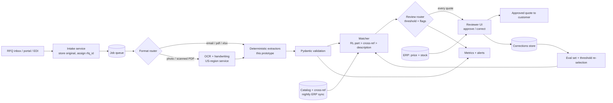

# Ridgeline Quote Desk

## Repository

https://github.com/abdullahek/ridgeline-quote-desk

A deterministic Python prototype that turns incoming RFQs (e-mail, forwarded chains, PDF, Excel, photos) into validated line items, matches them to the Ridgeline catalog with explainable confidence scores, and produces draft quotes for **human review**. No prices or stock levels are produced: those must come from Ridgeline's existing systems.

Status legend used below: **Implemented** = in this repository and tested. **Proposed** = production design, not built.

## How to Run

Requires Python 3.12 (tested on 3.12.10, Windows 11). No API keys, no network, no database.

```bash
# 1. Install
python -m venv .venv
.venv\Scripts\activate            # macOS/Linux: source .venv/bin/activate
pip install -r requirements.txt

# 2. Run the pipeline on all six RFQs -> outputs/<rfq_id>.json
python -m quote_desk.pipeline                    # review threshold from quote_desk/config.py (0.80)
python -m quote_desk.pipeline --threshold 0.85   # or override per run (or QUOTE_DESK_REVIEW_THRESHOLD)

# 3. Evaluate against answer_key/ (rfq_01..03) -> evaluation/results.json
python evaluation/evaluate.py

# 4. Tests and submission check
python -m pytest -q
python check_submission.py
```

| Path | Purpose |
|---|---|
| `quote_desk/schemas.py` | Pydantic models: catalog rows, extracted lines, submission output, evaluation results; closed `Flag` vocabulary |
| `quote_desk/extract/` | `email.py` (e-mails + forwarded chains), `tabular.py` (PDF via PyMuPDF, Excel via OpenPyXL), `__init__.py` (dispatch, image stub, failure handling) |
| `quote_desk/normalize.py` | Quantity / unit / identifier parsing and text normalisation |
| `quote_desk/reference.py` | Catalog, cross-reference and customer loading; customer identification |
| `quote_desk/matcher.py` | Part-number, cross-reference and description matching with confidence scores |
| `quote_desk/pipeline.py` | End-to-end CLI, review decision, JSON writer, per-RFQ latency |
| `evaluation/evaluate.py` | The **only** code that reads `answer_key/` |
| `tests/` | 64 tests (schemas, extraction, matching, evaluation logic, checker conformance) |

## Approach

### Pipeline (Implemented)

```text
RFQ file -> format dispatch -> extraction -> normalisation -> customer ID
        -> matching (RL part > cross-reference > description) -> confidence + flags
        -> review decision -> Pydantic validation -> outputs/<rfq_id>.json
```

**Extraction**
- **E-mail (.txt):** headers are parsed and forwarded/original messages are split. Item lines are found *structurally* (bullets, or the block after an intro line ending in `:`), not by looking for known products. Every other non-empty line is kept in `non_item_rows`, so nothing is silently dropped.
- **Forwarded chains:** the item list is taken from the message that contains it, then explicit revisions from later messages are applied oldest-first ("make the motor 5HP not 3", "bump the gaskets to 40", "grease is fine as is"). The original text stays in `as_written`, the change is recorded in `note`, and the line is flagged `revised_in_thread`. A change instruction that cannot be parsed flags the lines `unresolved_conflict` instead of being guessed.
- **PDF:** PyMuPDF word coordinates are grouped into rows and split at the header's column positions. (`find_tables` was tried and rejected: it dropped spaces inside cells.) There is a free-text fallback when no table header exists.
- **Excel:** the header row is detected from a column vocabulary (`Item #`, `Desc.`, `Qty`, `UOM`, `Notes`...). Title, contact and delivery rows become `non_item_rows`. "same as above but 1/2"" inherits the referenced line with the stated size substituted, and the original part number is **not** reused.
- **Photo (.png):** stubbed as one `stub` line with `needs_review: true` and an explanation. No handwriting recognition is attempted.
- **Failures:** corrupt, empty or unsupported files produce an `extraction_error` line plus an error message, never a crash or a missing RFQ.

**Normalisation rules**
- Specs are never edited. Only quotes, dashes and whitespace are unified.
- Quantity patterns are tried most-explicit-first (`qty N` > `, N boxes` > `- N` > `x N` > leading `N`), so sizes like `1/2-13 x 2"` are never read as quantities.
- **Nothing is invented.** No stated quantity gives `quantity: null` + `missing_quantity`; no stated unit gives `unit: null` + `missing_unit`. "300 (we usually get boxes)" stays `300`, no unit, flagged `ambiguous_quantity`.
- The customer is identified only on a unique hit: their name in the document, else the sender's e-mail domain.

**Matching and confidence (0-1)**

| Evidence | Base | Adjustments |
|---|---|---|
| Ridgeline part number as written | 0.97 | -0.30 + `low_confidence` if the customer's description contradicts it |
| Cross-reference (`cross_reference.csv`) | 0.95 | `close sub` -0.15 (`substitution`); other notes -0.10 (`cross_ref_note`); `dup?/confirm` -0.20; never verified -0.05; discontinued item replaced by catalog `replaced_by` -0.10 (`discontinued_replaced`) |
| Description (RapidFuzz `token_set_ratio`) | 0.50 + 0.30 x text + 0.05 per stated spec (max 3), cap 0.95 | Hard gate on *critical attributes*. Every stated size, thread, length, grade, seal type, HP/RPM, micron, MERV, pressure class, glove size and material must exist in the candidate, otherwise the candidate is rejected. Unit compatible +0.03 / incompatible -0.10. Runner-up within 0.05 gives `ambiguous_match`, capped at 0.60. No measurable specs: 0.30 + 0.50 x text and text >= 0.75 |

A line goes to review if it is unmatched, its confidence is below the threshold (0.80), or it carries a review flag: `stub`, `no_match`, `ambiguous_match`, `missing_quantity`, `ambiguous_quantity`, `unit_mismatch`, `substitution`, `discontinued_replaced`, `cross_ref_note`, `cross_ref_conflict`, `part_not_found`, `references_prior_order`, `unresolved_conflict` or `extraction_error`. Each line's `note` explains its score: matched specs, text similarity, the runner-up, cross-reference notes and replacements.

### Key decisions and trade-offs
- **Deterministic first, no LLM.** The prototype is reproducible, free per RFQ, explainable and keeps data local. The cost is more brittle prose understanding: thread revisions only cover a few phrasings.
- **Precision over coverage.** Critical attributes are a hard filter, so "3/8 x 3 gr5" finds *no* match rather than the nearest bolt. A typo in a spec becomes a miss that a reviewer sees, never a wrong part number.
- **Preserve uncertainty.** Uncertainty is shown with flags and `null`, never a guess. The closed `Flag` vocabulary makes flags countable for monitoring.
- **Output schema is the contract.** `RFQOutput` forbids unknown keys, so a price field cannot leak out. A test runs the official checker's validator on generated output.
- **Model provider and region:** **no external model is used in the prototype**. Everything runs locally and no RFQ data leaves the machine. Any production model or OCR service must run in a **US region** (see Production).

### Known limitations
- Handwritten photos and scanned PDFs are not transcribed. They are stubbed or flagged `extraction_error`.
- Thread-revision parsing understands only three phrasings. Anything else is flagged, not applied.
- The synonym list is small and hand-written (bolt->hex cap screw, SS->stainless, FP->full port...).
- When the customer states no unit, the catalog unit is not filled in. This lowers unit accuracy (see Evaluation).
- "6205 bearings sealed" (rfq_06) is matched to the 2RS (rubber sealed) bearing at 0.81 without review. That is defensible but borderline, and rfq_06 has no label to confirm it.

## Evaluation

`python evaluation/evaluate.py` runs the current pipeline in memory on the three labelled RFQs (`rfq_01`-`rfq_03`, 19 lines). It aligns predicted to expected lines by text similarity, sweeps thresholds, checks that `outputs/` matches a fresh run at the configured threshold, and writes `evaluation/results.json`. The answer keys are used for scoring only. The pipeline was **not** tuned to individual answer-key values.

**Definitions**
- *extraction_accuracy* = lines with correct quantity **and** unit / (expected + extra lines). Missing and extra lines both count against it.
- A line *asserts* a part only if it has one with confidence >= threshold; otherwise it abstains to a human.
- *Precision* = correct assertions / assertions. *Recall* = correct assertions / expected lines that have a part.
- *Correct abstention* = expected part is null and nothing is asserted.

**Results (measured)**

| Metric | Value |
|---|---|
| Lines aligned / missing / extra | 19 / 0 / 0 |
| Customer ID accuracy | 3/3 |
| Quantity accuracy | 19/19 = 1.000 |
| Unit accuracy | 16/19 = 0.842 |
| **extraction_accuracy** (qty and unit) | **0.842** |
| **match_precision / match_recall @ 0.80** | **1.000 / 1.000** (17 TP, 0 FP, 0 FN) |
| Correct abstentions | 2/2 ("same grease as last order", chlorine test kit) |
| Review rate (pipeline rule) | 0.263 (5/19 lines) |

| Threshold | Precision | Recall | Review rate |
|---|---|---|---|
| 0.50 - 0.85 | 1.000 | 1.000 | 0.263 |
| 0.90 | 1.000 | 0.647 | 0.421 |
| 0.95 | 1.000 | 0.588 | 0.474 |

**Selected threshold: 0.80** (same as `quote_desk/config.py`; `results.json` and `outputs/` are consistent).
- Selection rule: the highest recall with precision >= 0.95. Ties keep the configured value, otherwise the stricter one.
- On this data every threshold from 0.50 to 0.85 performs identically. 0.80 keeps a 0.05 margin below the lowest-confidence correct match (0.85).
- **Precision vs recall:** raising the threshold bought no precision here, because there were no false positives to remove. It only cost recall, as the 0.85-0.88 description matches and the noted or replaced cross-references fell below the bar. Lowering it below 0.80 would auto-accept weaker description matches that the unlabelled RFQs show exist.

**Honest caveats**
- **The 3 unit misses are a design choice.** "10 A42 v-belts" and "RL159429 x 3" state no unit, and "PAIL" is kept as written, while the answer keys always carry a unit. Filling the catalog unit when none is stated (with a flag) would raise this score, but it was not done after seeing the results, to avoid tuning to the key.
- **Three labelled RFQs (19 lines, 17 expected matches) is far too small.** 17/17 correct is consistent with a true precision well below 1. The hardest inputs (forwarded chain, messy e-mail, handwritten photo) have **no labels at all**.

**Growing the labelled set (Proposed)**
1. Pair historical RFQs with the quotes that were approved and sent: the approved line items are free labels for part numbers, quantities and units.
2. Log every reviewer correction (part changed, quantity fixed, line added or removed) as a labelled example. This is weighted toward the hard cases.
3. Sample live traffic by format and customer, double-label a small slice, and track agreement between labellers.
4. Report metrics per format (e-mail / PDF / Excel / photo) and per match method, and re-select the threshold only when the data actually separates the candidates.

## Production

Everything in this section is **Proposed** unless marked otherwise.

### Architecture



- **Data residency:** all storage, queues, compute, OCR and any LLM endpoint are deployed in **US regions only** (for example, an AWS or Azure US region, with model access through that cloud's US-region endpoint). Logs and backups stay in the same region, with no cross-region replication outside the US.
- **Pricing and stock** are read from the ERP at review time and are never produced by the pipeline (Implemented: outputs contain no price fields).
- **Human approval:** every quote is approved by a person. The threshold only decides which lines are pre-confirmed and which are highlighted for attention.

### Failures, retries and unsupported formats
- **Implemented:** an unreadable, corrupt, empty or unsupported file becomes an `extraction_error` line, so the RFQ still reaches a reviewer. A photo becomes a `stub`. An unparseable revision becomes `unresolved_conflict`.
- **Proposed:** idempotent jobs keyed by a content hash. Transient errors (OCR timeouts, ERP sync) get up to 3 retries with exponential backoff, then go to a dead-letter queue and alert. The original file is always kept for re-processing after a fix. Unsupported formats (.doc, .msg attachments, zip) are routed to manual entry with the reason shown. Password-protected PDFs get a customer auto-reply template.

### Reviewer feedback loop
- The reviewer sees `as_written`, the proposed part, its confidence, the `note` (specs matched, runner-up, cross-reference notes) and the flags.
- One-click actions: accept, choose the runner-up, search the catalog, edit the quantity or unit, split or merge lines, mark "not an item".
- Each correction is stored as `(rfq line, prediction, final answer, reason)`. Corrections that recur feed three places: proposed cross-reference rows (a customer's part number repeatedly mapped the same way), synonym additions, and the evaluation set.

### Monitoring and alerts

| Metric | Proposed alert |
|---|---|
| Extraction failure rate per format | > 5% over 1 hour, or any format at 100% |
| Lines per RFQ = 0 / stub rate | sudden spike vs 7-day baseline (template change) |
| Review rate | > 1.5x 7-day baseline |
| Reviewer override rate on auto-accepted lines (a precision proxy) | > 2% weekly. This is the most important alert |
| `no_match` / `part_not_found` rate | rising trend (catalog or cross-reference gaps) |
| Unidentified customer rate | > 10% |
| p95 processing latency | > 30 s per RFQ |
| Catalog / cross-reference sync age | > 24 h |

### Cost and latency per RFQ
- **Measured (prototype, local laptop):** 579-938 ms for all six RFQs in one process across runs (about 96-156 ms per RFQ on average, most of it the one-time PyMuPDF and OpenPyXL import). One CLI run took 2.06 s wall-clock including interpreter start-up. Model cost is $0 because no external model is used.
- **Estimated (production, not measured):** compute for deterministic extraction and matching is well under $0.001 per RFQ. Adding OCR for photos or scans is roughly $0.002-$0.02 per page. An optional LLM fallback, used only for lines that fail deterministic parsing, is roughly $0.005-$0.03 per RFQ depending on model and length. End-to-end latency is expected at 1-5 s without OCR or LLM and 5-20 s with them. The dominant cost remains reviewer time, which is why the review rate is a tracked metric.

### Two more weeks (prioritised)
1. **Labelled data:** build 100+ labelled RFQs from historical approved quotes, then re-measure and re-select the threshold per format.
2. **Photo and scan support:** US-region OCR/handwriting service for `rfq_04`-style requests, with the extracted text passed through the existing parsers and flagged as OCR-derived.
3. **Unit policy:** infer the catalog unit when none is stated (flagged `unit_inferred`) and add pack-size conversion such as 300 bolts vs box of 100, always shown to the reviewer.
4. **Constrained LLM fallback (US region):** only for lines or threads the rules cannot parse. Output is validated by the same Pydantic schemas and restricted to catalog part numbers, with `match_method: "llm"` and capped confidence.
5. **Reviewer UI and correction capture,** plus the cross-reference suggestion workflow.
6. **Productionise:** queue-based workers, ERP catalog sync, structured logs and the monitoring above.
